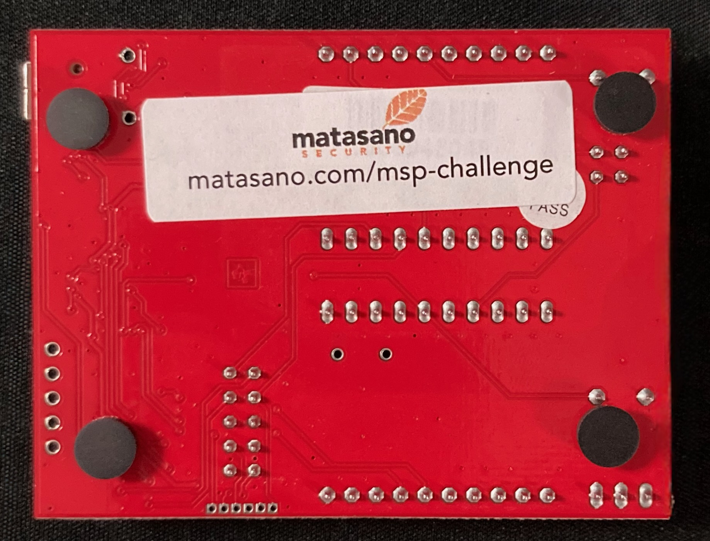
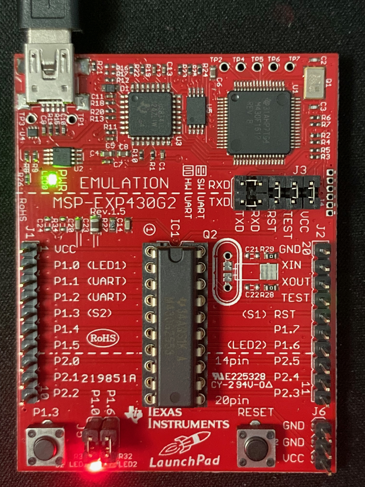
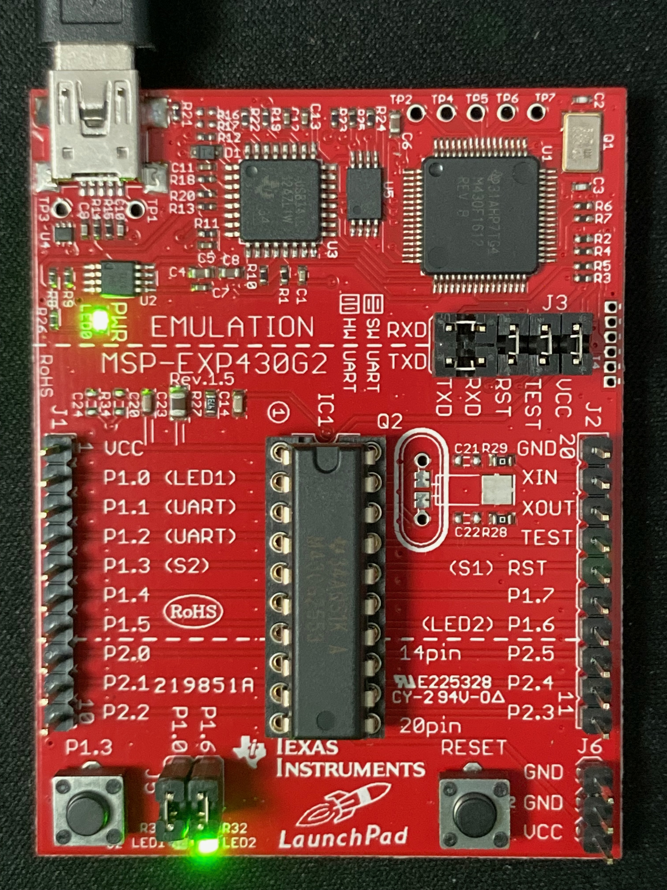

# Inception CTF



## Context (Updated)

For those of us who have worked infosec consulting for any length of time the term "engagement grind" brings to mind the typical ebb and flow of the engagement lifecycle and the mad dash to get the report ready for delivery.  This usually leads to long and late nights on Thursday cramming for Friday morning's readout.

As a means of fighting the post readout adrenaline dump (and subsequent consultant checkout) we started developing and sending out internal CTFs on Friday afternoons.  These things ranged in difficulty week to week; sometimes they were reproducing a popular zero day discovered earlier in the week, sometimes they were about a popular vulnerability making its way in the news (OpenSSL bugs were really big when I first started).

The Microcorruption challenges were successful enough that Matasano also began using them as part of its recruiting efforts. As part of the recruiting package, candidates would receive a TI LaunchPad development board containing a real MSP430 microcontroller, giving them the opportunity to explore the same architecture on physical hardware.

When it was my turn to create the CTF i ended up combining the two together into what I called Inception CTF. I took Microcorruptions New Orleans level and re-wrote it so that it would run on the actual MSP430.  Addresses had to change, but i spent a good amount of time making sure that it compiled to a very similar structure and instruction flow.   

## Intro

In that spirit, a new challenge has arrived!

~~~
Greetings, Matasanoans --

I have just received the first physical prototype from Lockitall for our Rev P-A.01 LockIT Pro board. Unfortunately, due to a hard drive crash, we lost the source code—and now we are locked out of our own locks!

We were so impressed by your previous work that we believe you have exactly the right set of capabilities to help us out of this predicament.
~~~

## DETAILS

~~~
DETAILS

    The LockIT Pro P-A.01 is the first of a new series of locks. It is
    controlled by a  MSP430 microcontroller, and is  the most advanced
    MCU-controlled lock available on the  market. The MSP430 is a very
    low-power device which allows the LockIT  Pro to run in almost any
    environment.

    The  LockIT  Pro   contains  a  Bluetooth  chip   allowing  it  to
    communiciate with the  LockIT Pro App, allowing the  LockIT Pro to
    be inaccessable from the exterior of the building.

    There is  no default password  on the LockIT  Pro---upon receiving
    the LockIT Pro, a new password must be set by connecting it to the
    LockIT Pro  App and  entering a password  when prompted,  and then
    restarting the LockIT Pro using the red button on the back.
    
    This is Hardware Version P-A. It contains  the Bluetooth connector
    built in, and one available port  to which the LockIT Pro Deadbolt
    should be connected.

    This is Physical Revision 01.
~~~

## Status LEDs

When the device is powered on, the program stored in flash is executed by the MSP430. The red LED will illuminate to indicate that the lock is in the **LOCKED** state.

When the lock is successfully opened, the red LED will turn off and the green LED will turn on indicating the **UNLOCKED** state.

| **LOCKED** | **UNLOCKED** |
|:---:|:---:|
|  |  |

## Unlock Procedure

The lock is controlled through a serial connection carried over USB to the MSP430's UART. When a user connects to the serial interface, the device displays a prompt requesting the password. The user enters the password and presses Enter. If the password is authenticated successfully, the lock transitions to the unlocked state.

## IMPORTANT NOTE (UPDATE)

I don't remember if this was always the case, but macOS has issues discovering the embedded serial device.

On macOS, the LaunchPad’s older TI USB interface does not expose its application UART as a normal /dev/cu.* serial device. Although the device presents a CDC-style interface, macOS does not bind its built-in serial driver to it correctly, so tools such as `screen` can't access the UART through a conventional serial port. To work around this, the project uses `PyUSB` with `libusb` to communicate directly with the LaunchPad’s USB interface and its bulk endpoints. The provided `launchpad_usb_uart_bridge.py` program performs this direct USB communication and presents the result to the user as an interactive terminal.

```console
$ python3 launchpad_usb_uart_bridge.py

[LaunchPad UART: 9600 8N1 interface=0 IN=0x83 OUT=0x03]
[Ctrl-C to exit]
Enter the password to continue
badpassword
Invalid password; try again.
```

```console
$ python3 launchpad_usb_uart_bridge.py

[LaunchPad UART: 9600 8N1 interface=0 IN=0x83 OUT=0x03]
[Ctrl-C to exit]
Enter the password to continue 
<correct password>
Access Granted!
[UART closed]
```
