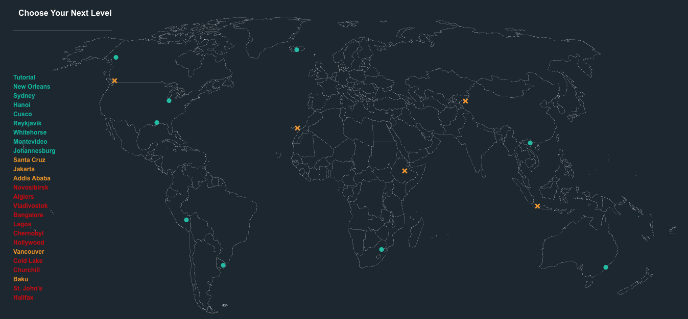
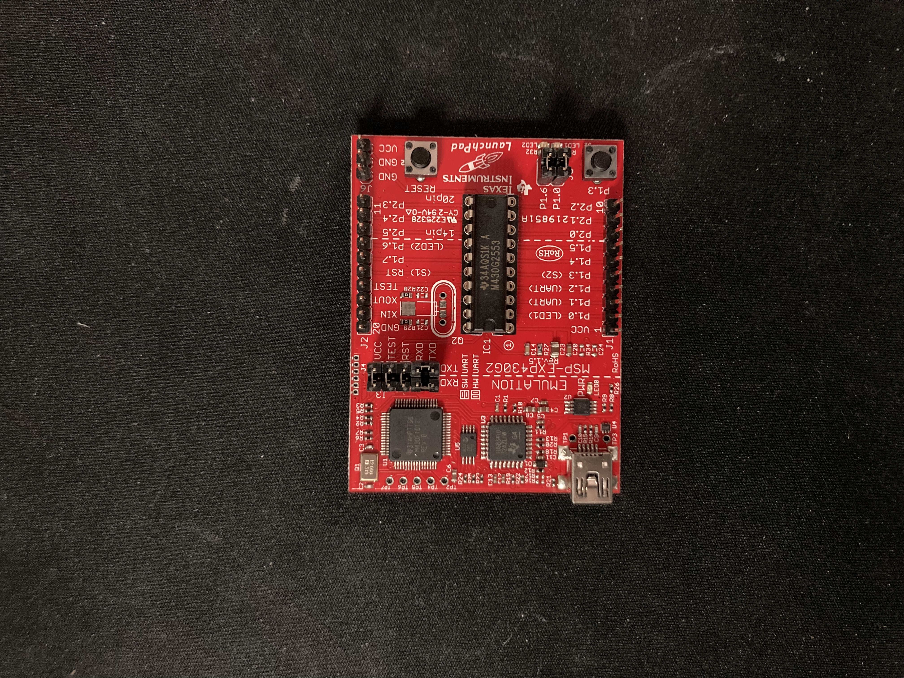
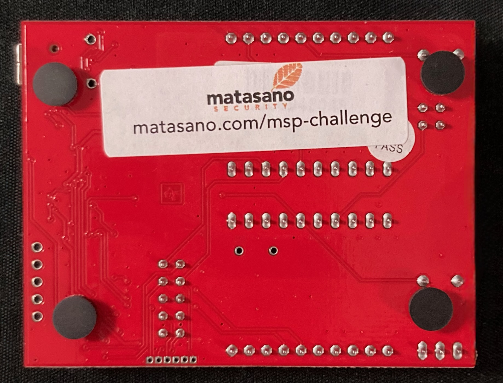

  

# History

I was hired by Matasano in July of 2014.  During the interview I learned about their embedded security CTF challenge.  Afterwards I went home and solved a bunch of the challenges and continued to work on them throughout my first month and the solutions were kept in a private repo.  My first month consisted of hacking on both microcorruption, cryptopals, and our super secure bank challenges.

Thomas H. Ptacek built the emulator and initial web interface for an internal Matasano hack night. According to his account, colleagues were still playing at 1 a.m., which persuaded him to turn it into a public CTF.  It launched with 18 challenges and a tutorial: New Orleans, Sydney, Hanoi, Cusco, Reykjavik, Whitehorse, Montevideo, Johannesburg, Santa Cruz, Jakarta, Addis Ababa, Novosibirsk, Algiers, Vladivostok, Bangalore, Lagos, Chernobyl, and Hollywood.  On October 22, 2022 NCC Group added six more challenges: Vancouver, St. John's, Cold Lake, Churchill, Baku, and Halifax.

Its original premise was a fictional Lockitall LockIT Pro electronic lock. Players received firmware disassembly, memory and register views, and a debugger; the objective was to find an input that opened the lock. Square’s launch post described a progression through assembly, buffer overflows, and DRM cracking, with an accessible starting point for programmers unfamiliar with the MSP430. 

It also served recruiting and outreach.  Ptacek helped popularize the use of public CTFs as a way to attract interested developers from the separate work-sample exercises used to assess candidates.  Thomas H. Ptacek, Hans Neilson, and Nicholas Carlini presented their work at [USENIX](https://www.usenix.org/conference/3gse14/technical-sessions/presentation/microcorupution-security-games-qualify-and-hire)

For a while, many companies were adopting these types of challenges to help with recruiting.  They work pretty well, although they do select for a certain type of personality.  Enjoy this walk through CTF history.

  
  

